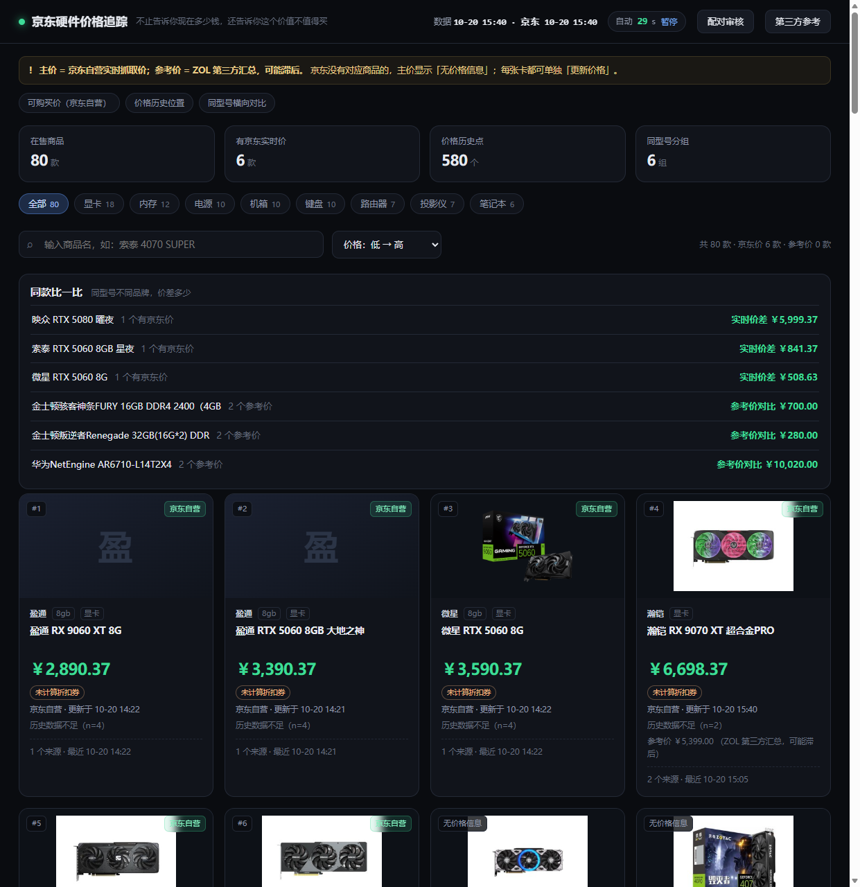

# 京东硬件价格追踪 · Price Tracker

> 不止告诉你现在多少钱，还告诉你这个价值不值得买。

一个**本地运行**的电脑硬件价格看板：京东自营可购买价 + ZOL 参考价 + 价格历史 + 同型号横向对比 + 第三方行情参考。

- 单文件前端（`web/index.html`，无框架、无 CDN）
- 零依赖后端（Node 22.5+ 内置 `node:sqlite` 与 `fetch`，**不需要 npm install**）
- 数据全部存本地 SQLite，**不采集个人信息、不上传任何数据**



---

## 一、30 秒跑起来

1. 安装 **Node.js 22.5 或更高**（<https://nodejs.org/>）
2. 双击 **`start-demo.cmd`**
3. 浏览器打开 <http://127.0.0.1:8787>

> 如果 node 不在 PATH，可设置环境变量 `PRICE_NODE` 指向 `node.exe` 的完整路径。

**默认看到的是仓库里带的那份数据**（80 个商品、约 600 个历史点），完全离线可用。

---

## 二、想让价格自己更新（可选）

### 2.1 手动跑一轮 ZOL 采集（本机）

**推荐：让 GitHub Actions 自动更新**（不用管电脑开不开）——见 §2.3。

本地想手动跑一轮：

或者用命令行：

```powershell
# 注册（每 60 分钟）
powershell -ExecutionPolicy Bypass -File .setup-schedule.ps1

# 改成每 30 分钟
powershell -ExecutionPolicy Bypass -File .setup-schedule.ps1 -Minutes 30

# 取消
powershell -ExecutionPolicy Bypass -File .setup-schedule.ps1 -Remove
```

它做的是：在 **Windows 任务计划**里创建一个名为 `PriceTracker-Collect` 的任务，每 60 分钟运行一次 `run-collect.ps1`。
可以用下面这条确认是否注册成功：

```powershell
Get-ScheduledTask -TaskName PriceTracker-Collect
```


不想挂计划任务，也可以**手动跑一次**：

```powershell
powershell -ExecutionPolicy Bypass -File run-collect.ps1
```

它做五件事：抓 8 个品类 → 去重 → 收敛数量 → 补图 → **导出快照**。
日志在 `logs/collect.log`。

> ⚠️ 采集需要联网，一轮约 4 分钟（约 120 个请求，每个间隔 2 秒）。
> 请保持这个节奏，别加速——ZOL 也会限速。

### 2.2 更新京东价（走公开接口，不需要登录）

京东价用**公开报价接口** `p.3.cn` 刷新，**不需要登录、不需要浏览器、不需要扫码**：

```powershell
# 一次刷新已绑定的 SKU（默认 20 个）
powershell -ExecutionPolicy Bypass -File .\update-jd.ps1
```

或者双击 **`更新京东价.cmd`**。

它做两件事：调接口取价 → 写库 → 重新导出快照。

> **可能遇到的情况**：部分网络会把 `p.3.cn` 解析到内网地址（DNS 污染），表现为全部 `CONNECT_TIMEOUT`。
> 这时候用 GitHub Actions 跑（海外 IP 通常正常），或者先不管——页面上会如实显示"无价格信息"或上次价格。
>
> 页面里的「更新价格」按钮走的也是这个接口（`/api/jd-price`），拿不到就返回
> `{"available":false,"reason":"fetch_failed","last_price":...}`，不会把旧价冒充成实时价。

### 2.3 让 GitHub 自己更新（推荐，零维护）

仓库自带 `.github/workflows/update-prices.yml`，**每 2 小时**自动做一次：

1. 抓 ZOL（显卡/内存/电源）
2. 尝试用 `p.3.cn` 公开接口刷新京东价（**不需要登录**；连不上会自动跳过）
3. 去重 → 收敛 → 补图 → 导出快照
4. 有变化就 commit 回仓库

启用方式（只需要一次）：

1. 把仓库推到 GitHub
2. 打开 **Settings → Actions → General → Workflow permissions**，选 **Read and write permissions**（否则机器人无法提交）
3. 到 **Actions** 标签，选「自动更新价格」，点 **Run workflow** 手动跑一次验证

之后仓库里 `data/snapshot.json` 与 `price.db` 会自己长数据，评审看 commit 记录就能看到更新。

> 说明：
> - ZOL 抓取在 GitHub 的海外 IP 上**可能被限速**，workflow 里每一步都加了 `|| true`，失败不会让整轮挂掉
> - 京东价靠 `p.3.cn`：国内网络常有 DNS 污染（你本机可能连不上），GitHub 上大概率可用；拿不到就自动跳过
> - 想要「评委本机也能自动更新」，再手动跑 `run-collect.ps1` 即可（不需要计划任务）

## 三、页面怎么读

| 位置 | 含义 |
|---|---|
| 大字价格 + 「京东自营」标签 | 京东自营页面的实时抓取价（**主价**）|
| 大字「无价格信息」 | 该商品没有关联到京东商品，**不拿 ZOL 价冒充** |
| 灰字「参考价 ￥xxx（ZOL 第三方汇总，可能滞后）」 | ZOL 参考价，只作参考，**不参与排序** |
| 「未计算折扣券」橙色小标 | 显示的是页面价（含平台自动立减），**你的个人券未计入** |
| 「历史数据不足（n=x）」 | 该商品历史点少于 5 个，**不下高低结论** |
| 「历史价格持平（n=x）」 | 历史价格从未变过 |
| 同款比一比 | 同型号不同品牌的价差 |
| 价格走势 | 可切「京东 / ZOL / 第三方(系列级)」|
| 第三方参考（底部）| B站「显卡日报」7 天数据，**非本站实测** |

**口径红线**：只有京东一个平台，所以不宣称"全网最低"；ZOL 价永远标注第三方汇总。

---

## 四、目录结构

```
src/               采集、解析、导出、服务、搜索匹配
web/index.html     前端（单文件）
data/price.db      SQLite（商品/报价/历史/映射）
data/snapshot.json 前端读取的快照（导出产物）
data/images/       本地商品图
data/bili/         第三方参考数据
docs/              设计文档（架构与数据口径）
tests/             自动验收
schema.sql         建表语句
```

## 五、自检

```powershell
node src\check.mjs            # 数据体检（快照/历史/图片/券口径）
node tests\accept-front.mjs   # 前端验收（27 条）
```

## 六、数据来源与免责

| 数据 | 来源 | 说明 |
|---|---|---|
| 主价 | 京东自营商品页 | 按需抓取，有缓存；不承诺实时 |
| 参考价 | ZOL 中关村在线 | 第三方汇总，可能滞后 |
| 第三方行情 | B站 @芝士华莱士「显卡日报」| 第三方整理，非本站实测 |

本项目仅用于学习与比赛演示；价格以各平台结算页为准。抓取请遵守目标站点规则，保持低频。

## 七、常见问题

| 现象 | 处理 |
|---|---|
| 提示找不到 Node | 装 Node 22.5+，或设 `PRICE_NODE` |
| 端口被占用 | `node src/serve.mjs --port 8790` |
| 页面空白/无数据 | 确认 `data/snapshot.json` 存在；跑一次 `node src/export.mjs` |
| 采集一直失败 | 看 `logs/collect.log`；ZOL 限速时等几分钟再跑 |
| 京东价全部「无价格信息」 | 正常：只有已绑定 SKU 且接口能取到价的商品才有主价 |
| 更新京东价全部 CONNECT_TIMEOUT | 本机 DNS 把 `p.3.cn` 解析到了内网地址；改用 GitHub Actions 跑，或忽略（页面会显示上次价格） |
